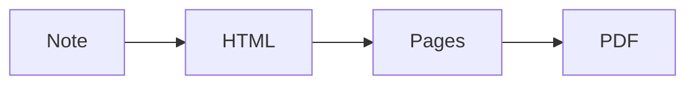

# Underrock sample note

A paragraph with **bold**, *italic*, ~~strikethrough~~, ==highlight==, `inline code`, a [link](https://obsidian.md), a link to [[#Tables|a section below]], a link to [[Another note]] and a #tag. Inline math: $e^{i\pi} + 1 = 0$.[^1]

## Math

$$
\int_{-\infty}^{\infty} e^{-x^2}\,dx = \sqrt{\pi}
$$

## Lists

- First item
- Second item
	- Nested item
1. One
2. Two
- [ ] An open task
- [x] A finished task

## Tables

| Engine | Platform | Output |
| ------ | -------- | ------ |
| HTML + Paged.js | Desktop | Vector PDF |
| Typst | Desktop and mobile | Vector PDF |

## Code

```ts
export function greet(name: string): string {
	return `Hello, ${name}!`;
}
```

## Callouts

> [!note] A note
> Callouts keep their colour and title.

> [!warning]- Folded callout
> Folded callouts are expanded in the PDF.

> A plain quote.

## Diagram



---

[^1]: A footnote.
